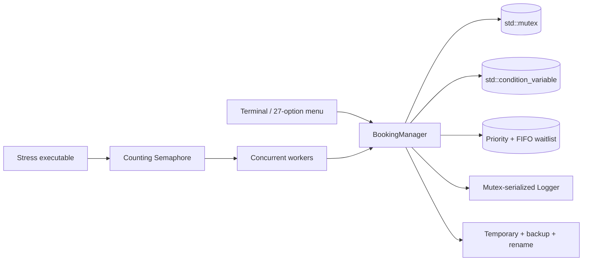

# RailSetu

RailSetu is a C++17, operating-systems laboratory project that models concurrent
railway reservation. It combines a mutex-protected booking engine, a
condition-variable availability wait, a counting semaphore start gate,
priority-aware FIFO waitlists, coach-seat allocation, refunds, cancellation
history, atomic versioned persistence, structured logs, ANSI terminal UI,
stress benchmarks, SVG/HTML/Mermaid exports, and automated tests.

The project requires no database or third-party runtime library. Every executable
uses the C++17 standard library and CMake 3.16 or newer.

## Documentation map

| Document | Audience and purpose |
|---|---|
| [evaluator guide](docs/evaluator_user_guide.md) | Exact build, test, demo, evidence, and viva workflow |
| [architecture](docs/architecture.md) | Components, invariants, transactions, file formats, diagrams |
| [OS concepts](docs/os_concepts.md) | Mutex, condition variable, semaphore, race, deadlock, fairness |
| [user manual](docs/user_manual.md) | Menu, commands, input syntax, exports, troubleshooting |
| [test cases](docs/test_cases.md) | Acceptance matrix, test targets, stress methodology |
| [team contributions](docs/team_contributions.md) | Ownership, deliverables, individual demo responsibilities |
| [synopsis](docs/synopsis.md) | Abstract, objectives, scope, institution, and team |
| [demo script](docs/demo_script.md) | Time-bounded presentation flow and expected observations |
| [screenshots](docs/screenshots.md) | Real terminal captures in text form and capture procedure |
| [viva questions](docs/viva_questions.md) | Technical questions and evaluator-ready answers |

## Repository layout

```text
.
├── CMakeLists.txt             CMake targets and CTest registration
├── Makefile                   Direct GNU Make alternative
├── README.md                  Project entry point
├── include/railsetu/          Public headers and data types
├── src/                       Application, UI, manager, persistence, logger
├── tests/                     Focused C++ acceptance tests
├── scripts/                   Build, run, and benchmark helpers
├── data/                      Runtime state and portable seed examples
├── logs/                      Activity and stress logs
├── benchmark/                 CSV, summary, and text report
├── reports/                   SVG, HTML, and Mermaid exports
└── docs/                      Complete project documentation
```

## Fundamental model



- `std::mutex` serializes every train, booking, PNR, seat, waitlist, and
  cancellation-history mutation.
- A confirmed-seat count is maintained separately and must remain
  `0 <= confirmed <= train.capacity`.
- PNR values are monotonic `RS00000001`, `RS00000002`, and so on.
- Priority is `SENIOR=3`, `LADIES=2`, `TATKAL=1`, `GENERAL=0`.
- Within a priority tier, `sequence` order implements FIFO.
- A confirmed cancellation refunds 80% of the paid fare.
- A waitlisted cancellation refunds zero.
- Normal persistence is a V2 text file; V1 is accepted only for loading.

## Build and test

Run commands from the workspace root.

### Windows PowerShell with the project MinGW toolchain

```powershell
Remove-Item -Recurse -Force build -ErrorAction SilentlyContinue
cmake -S . -B build -G "MinGW Makefiles" -DCMAKE_CXX_COMPILER=g++
cmake --build build --parallel
ctest --test-dir build --output-on-failure
```

The repository helper performs the same build and test sequence:

```powershell
.\scripts\build-and-test.ps1
```

The helper creates `build\railsetu_app.exe`, `build\railsetu_stress.exe`,
and `build\railsetu_tests.exe`.

### Linux and macOS

```sh
cmake -S . -B build
cmake --build build --parallel
ctest --test-dir build --output-on-failure
```

`scripts/build.sh` runs the CMake configure/build/test sequence.
`Makefile` provides direct GNU Make builds for `make`, `make app`,
`make stress`, `make test`, and `make clean`.

## Run

### Browser experience

RailSetu now includes a responsive browser-based control center in `web/`.
It is a dependency-free frontend with local browser storage; it runs separately
from the C++ command-line executable and does not currently call the C++ process
or share its state file.

Windows:

```powershell
.\scripts\start-web.ps1
```

Linux/macOS:

```sh
sh scripts/start-web.sh
```

Then open `http://localhost:4173`. To stop the local static server, press
`Ctrl+C`. The browser UI supports interactive reservations, seat selection,
waitlist promotion, booking cancellation/refunds, filters, concurrency
simulation, activity history, and local report downloads.

### Windows, current MinGW build

```powershell
.\build\railsetu_app.exe
.\build\railsetu_stress.exe 100 20
```

An isolated state and log can be supplied:

```powershell
.\build\railsetu_app.exe demo.state logs\demo.log
```

### Linux/macOS

```sh
./build/railsetu_app
./build/railsetu_stress 100 20
```

Or:

```sh
./scripts/run.sh
./scripts/stress_test.sh 100 20
```

With no existing state file, the application seeds:

| Train | Capacity | Coaches |
|---|---:|---|
| RS101 Rajdhani Express | 120 | A1 AC 60, S1 SLEEPER 60 |
| RS205 Deccan Queen | 80 | G1 GENERAL 80 |
| RS330 Shatabdi Express | 60 | A1 AC 60 |

## Quick demonstration

```text
list
seats RS101
book RS101 Alice 1 SENIOR
status RS00000001
search Alice
ladder RS101
cancel RS00000001
history
dashboard
export
exit
```

At startup, normal state is `data/railsetu.state` and logs are
`logs/activity.log`. State saves occur after successful mutation and when the
application exits.

## Command and menu reference

Menu options 1–27 and command-line forms include:

- `list`, `details`, and menu options 1–4 for train discovery
- `book`, `coach`, `seats`, and menu 5 for ticket and seat operations
- `cancel`, `refund`, `status`, and `search`
- `wait TRAIN SEATS TIMEOUT_MS`
- `history`, `save`, `backup`, and `restore`
- `unsafe-race` and `deadlock`
- `dashboard`, `route`, `ladder TRAIN`, `log`, `demo`, `export`, `report`

The complete syntax and menu behavior are in
[the user manual](docs/user_manual.md).

## Reports and exports

Menu 20 or command `export` writes:

| File | Content |
|---|---|
| `benchmark/railsetu_report.txt` | Train, confirmed, and waitlisted totals |
| `benchmark/benchmark.csv` | Appended thread benchmark rows |
| `benchmark/benchmark_summary.txt` | Latest stress summary |
| `reports/occupancy.svg` | Per-train occupancy bars |
| `reports/latency.svg` | Illustrative concurrency/latency graphic |
| `reports/priority.svg` | Priority-tier diagram |
| `reports/railsetu_report.html` | Browser-ready report embedding exported graphics |
| `reports/architecture.mmd` | Mermaid system architecture |

Open `reports/railsetu_report.html` in a browser. Render
`reports/architecture.mmd` in VS Code, GitHub Markdown, or Mermaid Live.

## Stress methodology

```powershell
.\build\railsetu_stress.exe 64 10
.\build\railsetu_stress.exe 100 20
```

The executable creates an isolated train capacity of 100, disables persistence,
uses a semaphore to release all workers together, then each thread performs
`bookings_per_thread` one-seat requests. It verifies:

- no confirmed total exceeds 100;
- no booking operation returns an unexpected failure;
- confirmed plus waitlisted accounting covers requested work.

Typical existing benchmark evidence: 100 threads × 20 requests yielded
100 confirmed, 1,900 waitlisted, and 0 failures. Timing varies with hardware.
