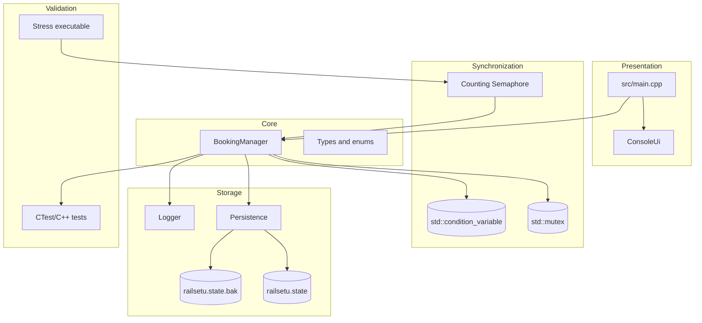
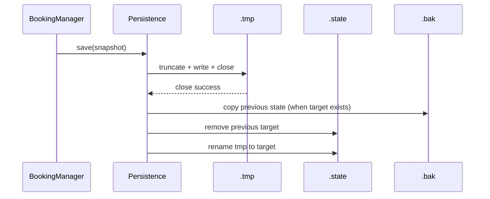

# RailSetu Architecture

## 1. Architectural overview

RailSetu separates presentation, synchronization, persistence, logging, and
benchmarking while keeping the single `BookingManager` mutex as the state
authority.



| Component | Responsibility | Key source |
|---|---|---|
| CLI | Parse menu/options, prompts, and command forms | `src/main.cpp` |
| Console UI | ANSI text, cards, grids, ladder, dashboard, reports | `src/ConsoleUi.cpp`, header |
| BookingManager | All reservation state and synchronization | `src/BookingManager.cpp`, header |
| Types | Enums, train/coach/booking records, result objects | `include/railsetu/Types.hpp` |
| Persistence | V1/V2 parsing, V2 writes, backup/restore | `src/Persistence.cpp`, header |
| Logger | Mutex-serialized text and structured JSON-like logs | `src/Logger.cpp`, header |
| Semaphore | Counting permit primitive | `include/railsetu/Semaphore.hpp` |
| Stress | Concurrent benchmark and invariant reporting | `src/stress.cpp` |
| Tests | Functional, concurrency, persistence, UI snapshot checks | `tests/*.cpp` |

## 2. Source layout and ownership

```text
include/railsetu/Types.hpp          Domain types and category priority
include/railsetu/BookingManager.hpp Complete manager API and shared members
include/railsetu/Persistence.hpp    State snapshot format API
include/railsetu/Logger.hpp         Logger API
include/railsetu/Semaphore.hpp      Header-only counting semaphore
include/railsetu/ConsoleUi.hpp      Terminal rendering API

src/main.cpp                        27-option CLI and report export
src/BookingManager.cpp              Transactions and synchronization
src/Persistence.cpp                 Disk serialization and validation
src/Logger.cpp                      Log serialization
src/ConsoleUi.cpp                   ANSI and ASCII rendering
src/stress.cpp                      Benchmark worker workload
```

## 3. Shared-state model

`BookingManager` owns these shared structures:

| Field | Meaning |
|---|---|
| `trains_` | Train identity, name, capacity, fare, and coach records |
| `bookings_` | PNR-indexed booking records |
| `waitlists_` | PNR deque per train |
| `confirmed_by_train_` | Total confirmed seat count per train |
| `sequence_` | Monotonic PNR and booking sequence source |
| `cancellation_history_` | Retained cancellation records |
| `persistence_enabled_` | Stress/demo control for automatic disk writes |

One `mutable std::mutex mutex_` protects every one of these fields and every
derived observer. `const` query methods use `std::lock_guard<std::mutex>` because
all shared state is mutable in the synchronization sense.

## 4. Core invariants

For every live train:

1. `0 <= confirmed_by_train_[id] <= capacity`.
2. A confirmed booking may not reuse a coach-seat label already assigned to
   another confirmed booking.
3. PNR values are unique among live and retained cancellation records.
4. A waitlisted PNR appears in exactly one train deque.
5. A waitlist PNR has `BookingStatus::Waitlisted`.
6. The queue is ordered by descending category priority and ascending sequence.
7. A promotion occurs only if the complete seat request fits the remaining
   capacity.
8. A cancellation of a waitlisted entry refunds zero and removes it from the queue.
9. A cancellation of a confirmed entry releases exactly `seats`, records an
   80% refund, and stores cancellation time/history.

## 5. Booking transaction proof

`book` executes this critical section:

```text
lock manager mutex
validate train, passenger, and seat count
generate unique PNR and sequence
compute fare
read confirmed total and train capacity
if seats fit:
  assign Confirmed
  increment confirmed total
  assign coach and unique seat labels
else:
  assign Waitlisted
  insert PNR by priority, then sequence
insert PNR -> booking in map
log result and notify condition-variable waiters
unlock
copy/persist snapshot
```

### Mutual-exclusion proof

Before thread B enters, thread A holds the mutex across capacity read,
confirmed-counter update, seat assignment, PNR generation, and map insertion.
Thread B cannot observe the intermediate state. Therefore exactly one competing
thread allocates an individual label or determines that it waits.

### Capacity proof

Let `U` be the confirmed total. On entry `U <= C`. For a request of `N`,
allocation requires `N <= C-U`. If satisfied, update becomes `U'=U+N <= C`.
Every waitlisted request contributes no confirmed count. No method under the
manager lock increases `U` beyond `C`.

## 6. Cancellation and promotion proof

Cancellation is one mutex-protected transaction:

```text
lock
find PNR
reject unknown/already-cancelled PNR
if Confirmed:
  U -= b.seats
  refund = 80% of fare
else:
  erase PNR from queue
set Cancelled and append history
notify availability waiters
walk deque head-to-tail:
  if request fits U + seats <= C:
    confirm and assign seats
    U += seats
  else:
    stop; leave queue and later entries unchanged
unlock
persist
```

The algorithm is head-draining only for requests that fit. A large senior
request can temporarily block the head and prevent a later smaller request from
promoting; this is strict queue-head behavior and is documented as a limitation.

## 7. Priority and FIFO proof

For category `c`, the priority function is:

| Category | Priority |
|---|---:|
| SENIOR | 3 |
| LADIES | 2 |
| TATKAL | 1 |
| GENERAL | 0 |

Insertion scans the deque until an entry with lower priority is found. Equal
priority entries are not displaced; because `sequence` is monotonic and insertion
uses sequence order on load, equal-priority FIFO is preserved.

On load, waitlisted records are copied and sorted into a vector by:

```text
category priority descending
booking sequence ascending
```

This reconstructs policy even if the original disk representation omitted queue
order. The queue remains explicit application data; the mutex scheduler does not
need to be fair.

## 8. Condition variable semantics

`wait_for_seats` uses:

```cpp
cv_.wait_for(lock, timeout, [&] {
    return seats <= train.capacity - confirmed_by_train_[train_id];
});
```

The wait atomically releases `mutex_` and sleeps. After notification, timeout,
or spurious wakeup, it reacquires the mutex and evaluates the predicate.
It does not wake on a failed booking; cancellation and successful confirmation
call `notify_all()`. Timeout accuracy is bounded by the implementation clock.
Waiting is for availability only; it does not reserve or enqueue the caller.

## 9. Counting semaphore semantics

`Semaphore` stores one permit count under its own mutex and condition variable.

| Operation | Zero permits | Available permits |
|---|---|---|
| `acquire` | Blocks | Decrements and returns |
| `try_acquire` | Returns false | Decrements and returns true |
| `release(n)` | Increases count, notifies all | Increases count |

In `src/stress.cpp`, the gate starts at zero and `release(thread_count)` makes
all worker permits simultaneously available. This is a start barrier-like
coordinate, not the reservation lock.

## 10. Locking and persistence invariants

The manager lock is not held across `save()` or `Logger` disk writes. Mutation
first unlocks, then `save()` obtains a snapshot under the manager lock.
This prevents disk latency from being included in the reservation critical
section.

The snapshot is:

```text
unordered_map trains
unordered_map PNR -> Booking
vector cancellation history
```

`save()` does not include derived waitlists or confirmed counters because
`load()` reconstructs both from trains and bookings. This avoids persisting
mutable derived state that could disagree with raw booking records.

## 11. Persistence format

The runtime file begins with `RAILSETU_STATE_V2`. V1 load support is retained
for `T` and `B` seed compatibility.

V2 records:

| Prefix | Fields |
|---|---|
| `T` | train ID, name, capacity, base fare |
| `C` | train ID, coach ID, type, seat count |
| `B` | PNR, train, passenger, seats, sequence, status, category, coach, fare, refund, cancellation time, seats |
| `H` | PNR, train, passenger, seats, refund, cancellation time |

CSV values are flattened by replacing commas and line breaks with spaces.
This is a conservative format and not a general JSON parser.

## 12. Atomic write protocol



Protocol properties:

- Serialization errors do not remove the previous target.
- The backup is copied before target replacement.
- `target.tmp` is adjacent to `target` so rename is on the same filesystem.
- Restore moves `.bak` back to the state path.
- Load requires the header and validates every reference and numeric field.

## 13. Load validation

The loader rejects:

- missing or unknown state header;
- empty or mismatched train IDs;
- zero train capacity;
- empty PNR or passenger;
- zero seats;
- unknown train reference;
- status outside the enum range;
- invalid category;
- confirmed records whose seats exceed remaining train capacity;
- malformed numeric fields through `invalid_argument/out_of_range` handling.

Loaded state is installed only after all records are processed and counters,
queues, and cancellation history have been reconstructed.

## 14. Terminal UI

The 27 menu entries include train discovery, booking, cancellation, waitlists,
stress, OS demos, exports, and live dashboards. ANSI escape sequences are enabled
on Windows only when a supported environment variable is found, and on Unix-like
systems unless `NO_COLOR` is set.

UI state is never authoritative. It obtains snapshots through manager query
methods, while mutations occur in `BookingManager`.

## 15. SVG/HTML/Mermaid exports

`export_visual_reports()` creates directories as needed and writes:

- occupancy SVG: per-train used/capacity percentages;
- latency SVG: a fixed illustrative concurrency line because the UI does not
  retain per-request timing history;
- priority SVG: four tier blocks;
- HTML report: summary cards and `` references to SVG files;
- Mermaid architecture: CLI → manager → locks/queue/storage;
- text report: train/confirmed/waitlisted totals.

The exports are snapshots. Re-run `export` after a state change to refresh them.

## 16. Limitations

- State is process-local and uses a process mutex, not cross-process locking.
- Persistence is text-based and does not provide database transactions.
- Seat allocation labels are coach-agnostic beyond coach choice; no berth/seat
  preference model exists.
- The HTML latency graph is illustrative, not reconstructed from a persisted
  timing series.
- The waitlist algorithm blocks behind an unfit head entry.
- The unsafe race and deadlock demos are bounded simulations, not kernel-level
  race/deadlock construction.
- The CLI does not implement authentication or concurrent remote clients.

## 17. Future scope

Candidates include PostgreSQL/SQLite transactions, POSIX/file locks for
multi-process access, a REST API, database-backed seat constraints, round-robin
or deadline-aware scheduling, real wait-graph deadlock detection, automated
thread sanitizers, and browser or TUI frontend integration.
