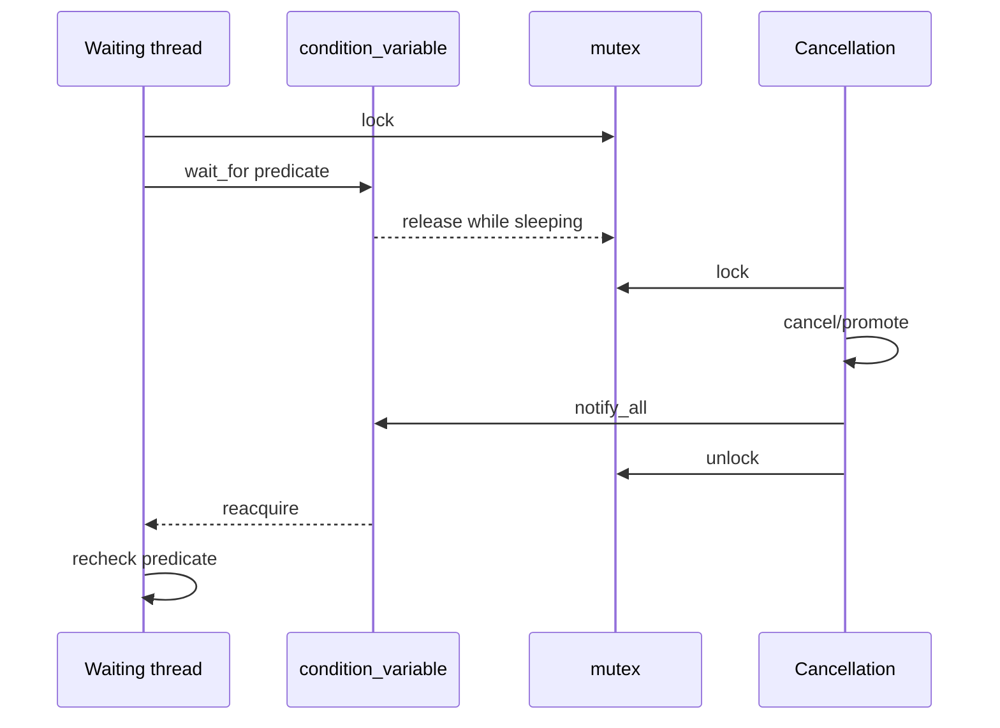

# Operating Systems Concepts in RailSetu

## 1. Shared resources

Railway capacity is a finite shared resource. Train objects, PNR records,
coach-seat labels, waitlists, confirmed counters, refunds, and cancellation
history are process-memory resources accessed by threads and the interactive CLI.

Every normal reservation operation crosses one transaction boundary:

```text
read train capacity
read confirmed seats
read seat labels
choose/confirm or waitlist
update counters/maps/queues
assign PNR
persist snapshot
```

If those operations are interleaved, lost updates or duplicate seat labels can
occur.

## 2. Process and threads

The stress executable creates `std::thread` objects. Each thread represents an
independent passenger request. Threads share the same address space and
`BookingManager` instance, so every shared field requires synchronization.

The CLI uses one foreground thread for parsing. Menu 6 additionally creates
100 worker threads for an isolated in-process demonstration.

## 3. Mutual exclusion

`BookingManager::mutex_` is the primary mutual-exclusion primitive.
`std::lock_guard<std::mutex>` is used for most transactions, and
`std::unique_lock<std::mutex>` is used for condition-variable waiting.

A critical section is not declared by a comment; it is the lexical scope of
lock acquisition. The PNR, capacity, booking, seat, and waitlist operations
share the same lock, eliminating split transaction views.

## 4. Lock granularity

RailSetu uses one manager mutex rather than separate train locks. This is coarse
but simple: it guarantees all derived structures remain internally consistent.
It serializes unrelated trains and may reduce throughput under many trains.
Future design could use striped train locks plus a PNR index lock, but the
current team prioritizes proof of correctness over high parallelism.

## 5. Booking critical-section trace

```cpp
std::lock_guard<std::mutex> lock(mutex_);
// validate
// generate PNR
// read capacity
// assign coach/seats or waitlist
// update bookings and confirmed counters
// notify condition variable
```

Persistence and application logging occur outside the lock when possible.
This keeps disk I/O out of the critical section.

## 6. Synchronization proof

Let:

- `C` = train capacity;
- `U` = confirmed-seat count;
- `N` = requested seat count.

The lock establishes the relation `U <= C` at entry. A request is confirmed
only if `N <= C-U`. The state transition is `U := U+N`, giving
`U <= C-U?` Algebraically:

```text
N <= C-U
U+N <= C
```

No other thread updates `U` while the first thread owns the mutex. After unlock,
the invariant remains true. This is a mutual-exclusion-based safety proof.

## 7. Liveness and starvation

The mutex and waitlist do not guarantee fair acquisition of the mutex.
The application enforces waitlist fairness independently:

```text
highest priority first
sequence FIFO inside the priority tier
```

There is no permanent priority-queue starvation prevention for high-priority
traffic. Head-of-line behavior can also delay all following entries when a large
head request does not fit.

## 8. Condition variable

`std::condition_variable` is used for timeout-based availability waiting.
Its associated mutex is `mutex_`.



Spurious wakeups are safe because waiters evaluate the predicate each time.
Timeout wakeups perform the same predicate check.

## 9. Semaphore

A mutex is binary and identifies ownership. A counting semaphore counts permits
and does not have a reservation owner.

In `include/railsetu/Semaphore.hpp`:

| State | `acquire()` | `try_acquire()` |
|---|---|---|
| count=0 | Wait | false |
| count>0 | Decrement | Decrement and true |

`release(n)` increments under the semaphore mutex and handles overflow by throwing
`std::overflow_error`.

The benchmark gate starts with zero permits and releases `thread_count` permits.
This makes worker threads runnable in one event rather than letting one thread
progress before the others start.

## 10. Race conditions

An unsafe race can occur if a thread:

```text
read availability
another thread changes availability
first thread writes a stale allocation
```

The normal manager eliminates this interleaving with the mutex.

The `unsafe-race` menu command calls `unsafe_race_demo()`. It creates eight
threads sharing isolated atomic demonstration counters. It intentionally reads
a stale availability snapshot and updates an allocation counter. It does not call
`book`, `cancel`, or persistence.

Atomic variables in this demo prevent undefined C++ data races while preserving
the logical lost-update demonstration. The correct result is data-dependent,
and the method reports no real booking result.

## 11. Lost update

The isolated requested/allocated counters demonstrate a read-modify-write
sequence:

```text
A reads 1000
B reads 1000
A subtracts 1
B subtracts 1
allocator updates can lose intended decrements
```

The normal booking uses a lock around one read-modify-write transaction, so
its operation count is not subject to this stale snapshot pattern.

## 12. Deadlock

A deadlock has simultaneous holding and waiting:

1. Thread A holds lock 1 and waits for lock 2.
2. Thread B holds lock 2 and waits for lock 1.
3. Neither can proceed.

RailSetu's real manager has one lock. It does not acquire logger or persistence
locks while holding the manager lock. The deadlock demo explicitly creates two
mutexes and uses:

```cpp
std::lock(first, second);
std::lock_guard<std::mutex> a(first, std::adopt_lock);
std::lock_guard<std::mutex> b(second, std::adopt_lock);
```

Both threads attempt to acquire in one operation, avoiding circular-wait
ordering.

## 13. FIFO semantics

FIFO means “arrival sequence within equal priority,” not execution order of
CPU threads. The sequence is assigned while the manager lock is held.

Insertion:

```text
for each PNR in queue:
  if new priority > entry priority:
    insert before entry
  else:
    continue
append if no higher-priority point found
```

Promotion walks the deque from head and advances only while entries fit. It
does not rescan for a later smaller entry after a head-blocking request fails.

## 14. Cancellation semantics

Confirmed cancellation is not merely “free one seat.” It also:

- subtracts the exact requested seat count;
- computes 80% of stored `fare_paid`;
- stores cancellation UTC text;
- changes status to cancelled;
- appends a cancellation record;
- wakes condition-variable waiters;
- scans and promotes waitlist entries.

Waitlisted cancellation removes the PNR and does not calculate an allocation
refund.

## 15. Persistence consistency

Disk I/O is outside the critical section, but state is snapshotted under lock.
The snapshot and serialization represent one logically complete manager state.

`load()` reconstructs:

- confirmed counters by summing confirmed bookings;
- waitlists by sorting waitlisted records;
- PNR sequence by maximum PNR/sequence field;
- cancellation history directly from persisted history records.

This is a crash-consistency approach, not a distributed database protocol.

## 16. Logging synchronization

`Logger` has a separate mutex. Multiple manager threads can call `log()` without
line interleaving. The log appends to a text file. JSON-like structured overload
sorts field names for deterministic output.

## 17. Stress and empirical evaluation

The benchmark uses the real manager lock and real booking/PROMOTION logic.
Persistence is disabled to isolate synchronization and CPU cost.

It records:

```text
threads
requested
confirmed
waitlisted
failures
elapsed_ms
```

The stress executable returns failure when the confirmed count exceeds capacity
or when any booking call unexpectedly fails.
